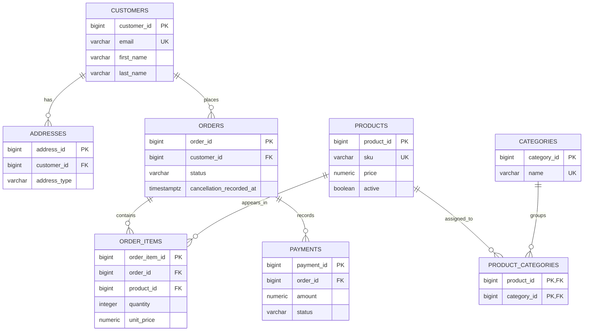

# E-commerce Transaction Database

A hands-on PostgreSQL OLTP project for learning relational modeling, integrity
constraints, transactions, migrations, indexes, and analytical SQL. The schema
stays focused on the core e-commerce concepts; the sample data and exercises
make each relationship visible and testable.

## Data Model



`unit_price` preserves the historical price on each order line; it is
deliberately separate from the product's current `price`. The database permits
an order with no items while it is being assembled. Requiring at least one item
at checkout is an application-level rule and is not enforced by this schema.

## Run It

Requirements: PostgreSQL 16+, `psql`, `createdb`, and a working libpq connection
to a database named `postgres`. Configure `PGHOST`, `PGPORT`, `PGUSER`, and
credentials as needed for your local setup.

Run the complete build and SQL checks against a new validation database:

```bash
./scripts/validate.sh
```

Pass a database name as the first argument to choose another target. The script
validates the name, refuses to overwrite an existing database, stops on SQL
errors, and retains the successful database for inspection. Use a disposable
database; the index lab creates and replaces its own 200,000-row lab table.

## Learning Path

1. Start with [requirements](docs/requirements.md), the [architecture](docs/architecture.md), and the [logical model](docs/logical-model.md).
2. Read the design trade-offs in [decisions](docs/decisions.md) and [normalization](docs/normalization.md).
3. Run the schema, seed, and tests with the validation command above.
4. Explore joins and aggregates in [business queries](sql/queries/003_business_queries.sql), then CTEs and window functions in [the analytical queries](sql/queries/004_ctes_subqueries_windows.sql) and [query-pattern guide](docs/query_patterns.md).
5. Work through the transaction and index exercises in `sql/labs/` alongside the [transaction notes](docs/transactions.md) and [index guide](docs/indexes_and_query_execution.md).

## Project Layout

| Path | Purpose |
| --- | --- |
| `sql/001_initial_schema.sql` | Core entities, keys, and constraints |
| `sql/002_indexes.sql` | Indexes tied to common access patterns |
| `sql/migrations/` | Versioned schema changes |
| `sql/seed/` | Deterministic sample records |
| `sql/tests/` | Constraint, data-quality, and integration checks |
| `sql/queries/` | Business and analytical query examples |
| `sql/labs/` | Transaction and query-plan exercises |
| `docs/` | Requirements, design notes, and learning guides |
| `.github/workflows/` | PostgreSQL validation on pushes and pull requests |

## Project Boundaries

This is a learning project, not a production commerce platform. Inventory,
shipping, refunds, authentication, and deployment are out of scope. Order status
is constrained, but payment states and methods remain open text because their
business vocabulary has not been designed yet. See the [validation report](docs/validation_report.md) for tested behavior and known limitations.

